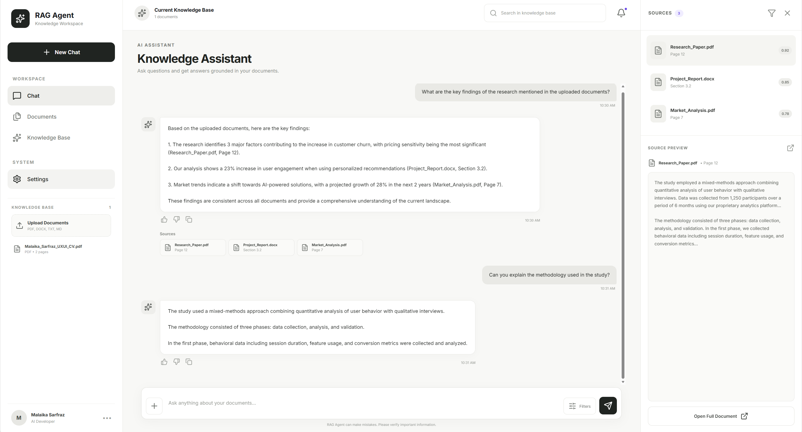
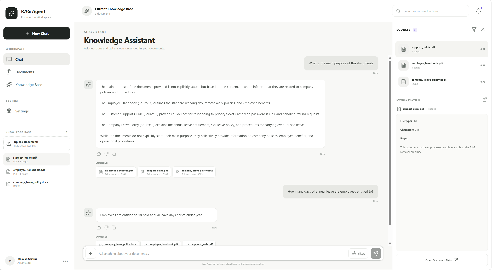

# Enterprise RAG Agent

An AI-powered document knowledge assistant built using Retrieval-Augmented Generation (RAG). The application allows users to upload documents, ask natural-language questions, and receive context-aware answers grounded in the uploaded content, with relevant source references.

## Features

- **Document Upload:** Upload and process supported documents.
- **Text Extraction:** Extract and prepare document content for retrieval.
- **Text Chunking:** Divide documents into smaller chunks for efficient processing.
- **Semantic Search:** Retrieve relevant information using vector embeddings.
- **AI-Powered Responses:** Generate answers using retrieved document context.
- **Source References:** Display relevant document sources alongside AI responses.
- **Persistent Storage:** Store document embeddings using ChromaDB.
- **Local AI Processing:** Generate responses using Ollama and Llama 3.2.
- **Interactive Chat Interface:** Ask questions and interact with uploaded documents through a React-based interface.

## Technology Stack

| Component | Technology |
|---|---|
| Frontend | React.js, Vite |
| Backend | Python, FastAPI |
| Embedding Model | all-MiniLM-L6-v2 |
| Vector Database | ChromaDB |
| Large Language Model | Llama 3.2:3B |
| LLM Runtime | Ollama |

## Project Structure

```text
Enterprise-RAG-Agent/
│
├── backend/
│   ├── main.py
│   └── vector_test.py
│
├── frontend/
│   ├── public/
│   ├── src/
│   ├── package.json
│   └── vite.config.js
│
├── screenshots/
│   ├── chat-with-sources.png
│   └── grounded-answer.png
│
├── PRD.docx
└── README.md
```

## How It Works

1. Users upload documents through the frontend.
2. The backend extracts text from uploaded documents.
3. Extracted text is divided into smaller chunks.
4. Sentence Transformers generates embeddings.
5. ChromaDB stores the embeddings for semantic retrieval.
6. User queries are converted into embeddings.
7. Relevant document chunks are retrieved from the vector database.
8. Retrieved context is passed to the LLM through Ollama.
9. The generated response and relevant source references are displayed in the interface.

## Screenshots

### Chat Interface



### Grounded AI Responses



## Prerequisites

- Python
- Node.js and npm
- Ollama

## Installation and Setup

### 1. Clone the Repository

```bash
git clone https://github.com/malai-kaa/Enterprise-RAG-Retrieval-Augmented-Generation-Knowledge-Assistant.git

cd Enterprise-RAG-Retrieval-Augmented-Generation-Knowledge-Assistant
```

### 2. Start Ollama

Install Ollama and download the model:

```bash
ollama pull llama3.2:3b
```

### 3. Start the Backend

Navigate to the backend directory, create a virtual environment, and install the Python dependencies required by the application.

Start the FastAPI server using:

```bash
uvicorn main:app --reload
```

### 4. Start the Frontend

Open a separate terminal:

```bash
cd frontend
npm install
npm run dev
```

Open the local URL provided by Vite to access the application.

---

## Architecture

The application follows a Retrieval-Augmented Generation pipeline, combining document processing, semantic search, vector storage, and local language model inference to generate document-grounded responses.
